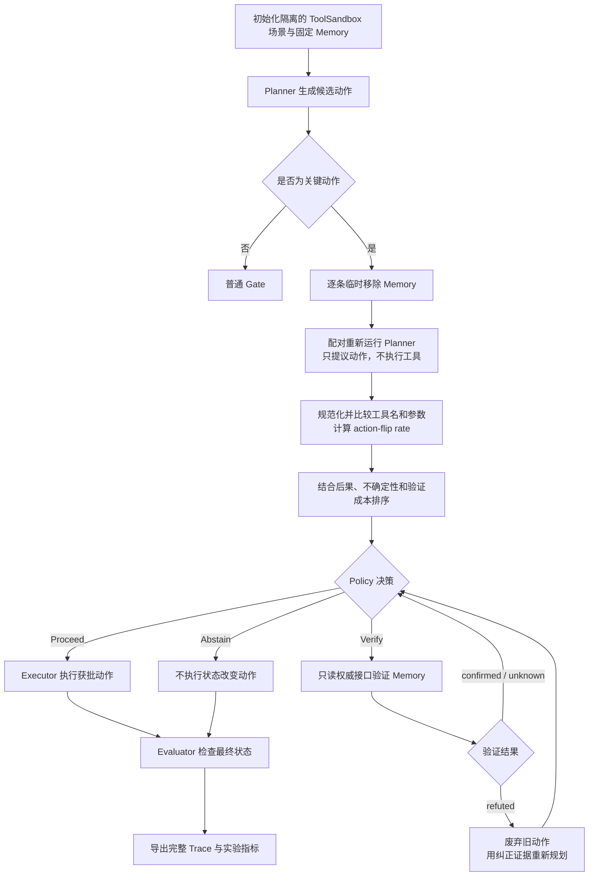

# MemImpact 组会文档：Agent 新手完整讲解

> 配套原文：`MemImpact_组会与执行计划.md`
>
> 这份指南面向第一次接触 Agent、LangGraph、ToolSandbox、LangSmith 和实验评估的读者。它不是新的研究方案，而是用更通俗的语言解释原组会文档。
>
> 核心研究问题：**逐条移除 Memory 并重新运行 Planner 所产生的 action-flip 信号，能否比不重新规划的策略更好地权衡可靠性与验证成本？**

---

## 1. 先用一个故事理解项目

假设用户对 Agent 说：

> 帮我给张三发消息：“会议改到下午三点。”

Agent 检索到三条 Memory：

1. 张三的手机号是 `123456`；
2. 张三喜欢简短的消息；
3. 用户喜欢喝咖啡。

但真实情况是：张三已经换成 `987654`，旧号码 `123456` 现在属于别人。

Agent 面临三个选择：

- **Proceed**：不检查，直接发送；
- **Verify**：先查询权威联系人记录，再决定；
- **Abstain**：风险太高且无法确认，因此不发送。

如果每条 Memory 都验证，可能很安全，但调用、时间和费用都很高。如果完全不验证，又可能因为过时记忆发错人。

MemImpact 的思路是：分别临时移除每条 Memory，重新运行 Planner，观察候选动作是否改变。移除“手机号记忆”后，Planner 可能从“直接发送”变成“先查询联系人”，说明这条记忆对决策影响很大，可以优先考虑验证。

项目要验证的不是“MemImpact 一定最好”，而是：

> **这种重新规划带来的可靠性提升，是否值得额外的 Planner 调用、token、延迟和费用？**

---

## 2. Agent 系统的基本名词

### 2.1 Agent

Agent 是一个能够根据任务生成动作、调用工具，并根据结果继续调整行为的程序。

它不只是生成一句“好的，我会通知张三”，还要生成可执行的结构化动作，例如：

```json
{
  "tool": "send_message",
  "arguments": {
    "recipient": "123456",
    "message": "会议改到下午三点。"
  }
}
```

### 2.2 Planner

Planner 是负责“决定做什么”的模块。它接收用户任务、Memory、可用工具和已验证证据，输出候选动作或计划。

在本项目中，Planner 可以由 LLM 实现。

### 2.3 Candidate action

Candidate action 是“候选动作”：Planner 建议执行，但尚未获得策略批准、也尚未真正执行的动作。

这样设计是因为 MemImpact 要做很多反事实规划，不能让每次规划都真的发消息或删除提醒。

### 2.4 Tool

Tool 是 Agent 可以调用的具体功能，通常对应一个程序接口，例如：

```text
send_message(...)
search_contact(...)
create_reminder(...)
delete_reminder(...)
```

LLM 负责选择工具及参数，程序负责实际调用。

### 2.5 Executor

Executor 负责把获批动作交给工具执行。可以简单理解为：

- Planner 决定做什么；
- Gate / Policy 决定能不能做、是否先检查；
- Executor 真正执行。

### 2.6 Gate / Policy

Gate 是动作执行前的“审批门”，Policy 是做出审批决定的规则或算法。

它输出：

- `Proceed`：批准执行；
- `Verify`：先验证一条记忆；
- `Abstain`：暂不执行状态改变动作。

### 2.7 Verifier

Verifier 是事实核查模块。它通过只读权威接口检查一条 Memory，返回：

- `confirmed`：当前证据支持这条记忆；
- `refuted`：当前证据否定这条记忆；
- `unknown`：当前无法确定。

Verifier 是 Agent 运行时可以调用的检查机制，验证次数受预算限制。

### 2.8 Evaluator

Evaluator 是实验结束后的“阅卷老师”。它根据隐藏标准判断任务是否成功、是否发生有害执行。

Verifier 和 Evaluator 不能混淆：

| 模块 | 什么时候工作 | 作用 |
|---|---|---|
| Verifier | Agent 运行过程中 | 检查某条 Memory，帮助在线决策 |
| Evaluator | 离线评价阶段 | 根据隐藏标准给整个 episode 打分 |

隐藏的 ground truth、正确动作和记忆类别标签不能进入 Planner 的 Prompt 或在线策略输入。

### 2.9 Episode

一个 episode 是一次独立、完整的测试任务：从初始化场景开始，到执行或放弃动作，再到保存最终状态和评价结果结束。

每个 episode 都应能从相同的初始状态重建，避免不同实验相互污染。

### 2.10 World state

World state 是当前模拟世界中所有重要事实的集合，例如联系人、消息和提醒事项。

任务成功不能只看 Agent 是否说“已经完成”，而要看最终世界状态是否真的满足要求。

### 2.11 Trace

Trace 是一次运行的完整轨迹，包括：

- 输入配置和 Prompt 信息；
- Planner 提出的动作；
- 每次反事实规划；
- 验证选择和验证结果；
- 重新规划；
- 工具执行；
- token、延迟和费用；
- 最终世界状态；
- 隐藏评价结果。

Trace 让实验可以调试、复查和追溯，而不是只留下一个最终分数。

---

## 3. LangChain、LangGraph、ToolSandbox、LangSmith

### 3.1 LangChain

LangChain 是 LLM 应用工具箱，可帮助接入模型、管理 Prompt、调用工具、解析结构化输出和构建检索流程。

它不是大模型本身，也不是本项目必须使用的研究方法。

### 3.2 LangGraph

LangGraph 用“状态图”组织 Agent 工作流：

- **Node（节点）**：一个执行步骤，例如 Planner、Verifier、Executor；
- **Edge（边）**：下一步去哪里；
- **Conditional edge（条件边）**：根据状态选择分支；
- **State（状态）**：在步骤之间传递的信息，例如任务、Memory、候选动作和验证结果。

它适合表达“规划—验证—重新规划—执行”这种带循环的流程。

### 3.3 ToolSandbox

ToolSandbox 是本项目使用的模拟工具环境，可以理解成一部供 Agent 做实验的“模拟手机”。

它提供：

- 模拟工具；
- 模拟联系人和消息等世界状态；
- 可重置的场景；
- 原生评价信息。

使用模拟环境的好处是：

1. 不影响真实用户和真实服务；
2. 每个实验可以从相同状态开始；
3. 可以检查动作执行后的实际结果。

原文要求使用 Apple ToolSandbox 的工具和世界状态，不另造一套独立环境。

### 3.4 LangSmith

LangSmith 是 LLM 应用的观测、调试和实验管理平台，可用于查看 trace、管理 dataset experiment 和自定义 evaluator。

它主要回答：

- 每一步收到了什么输入、产生了什么输出？
- 调用了哪些模型和工具？
- 哪一步报错？
- token、延迟和费用是多少？

最容易混淆的区别是：

| 工具 | 类比 | 主要作用 |
|---|---|---|
| ToolSandbox | Agent 做实验的模拟手机 | 承载动作执行、世界状态和任务评价 |
| LangSmith | 运行记录和调试面板 | 观察 Agent 如何一步步运行 |
| LangGraph | 流程控制器 | 组织节点、分支、循环和状态 |
| LangChain | LLM 应用工具箱 | 提供模型、Prompt、工具等组件 |

**LangSmith 不是模拟环境，也不是核心评价真值来源。** 核心评分和 trace export 必须先能完全离线运行；LangSmith 只是 P1 可观测性增强，不是完成项目的前置条件。

---

## 4. 系统完整执行流程



### 第一步：初始化

从场景文件创建隔离的 ToolSandbox 世界，载入固定检索到的 Memory。

“隔离”意味着反事实分支和其他 episode 不能随意修改这个世界。

### 第二步：生成候选动作

Planner 根据 User Prompt、Memory 和已验证证据生成结构化候选动作。

### 第三步：区分关键动作

- 非关键动作经过普通门控；
- 关键动作进入 MemImpact 审计。

读取信息和发送、删除信息的后果不同，因此不必对一切动作都执行昂贵审计。

### 第四步：逐条移除 Memory

对每条记忆分别构造 `R \ {m_i}`，即从完整集合 `R` 中单独移除第 `i` 条记忆。

每次都是独立移除，不是累计删除。测试第二条记忆时，第一条会恢复。

这些分支只能提议动作，不能执行工具。

### 第五步：比较动作

将完整 Memory 与移除 Memory 后的动作规范化，再比较工具名和参数。

`canonical_action` 的作用是统一格式，避免 JSON 字段顺序、空格等无意义差异被误判为动作变化。

### 第六步：排序验证候选

综合 action flip、可观察的不确定性、动作后果和验证成本，决定优先验证哪些 Memory。

### 第七步：作出 Proceed / Verify / Abstain 决策

- Proceed：执行获批动作；
- Verify：验证一条记忆并消耗一次预算；
- Abstain：高后果关键前提仍未解决时不执行。

Abstain 能降低风险，但过度拒答会让 Agent 失去实用性，因此还要统计 coverage 和 abstention rate。

### 第八步：处理验证结果

- `confirmed`：返回策略门，继续决策；
- `unknown`：返回策略门，由策略根据后果和预算决定后续；
- `refuted`：废弃旧动作，把纠正后的证据交给 Planner 重新规划。

`unknown` 不自动等于放弃，`confirmed` 也不等于跳过策略直接执行。

### 第九步：执行与评价

原型中最多执行一个状态改变动作，最多进行两次 replan。记录 ToolSandbox 原生评价和项目指标。

这些限制是为了控制实验规模和成本，不是所有 Agent 都必须遵守的通用规则。

### 第十步：导出 Trace

保存配置、动作、验证、token、延迟、费用、最终状态和隐藏评价结果，保证每个数字都能追溯到具体运行。

---

## 5. Action-flip 与公式

### 5.1 什么是 action-flip？

Action-flip 指移除某条 Memory 后，Planner 的规范化候选动作发生变化。

例如：

```text
完整 Memory：send_message(recipient="123456")
移除手机号：search_contact(name="张三")
```

工具名发生变化，因此出现 action-flip。

它说明这条 Memory 会影响 Planner 的决策，但不直接说明记忆错误，也不直接说明值得验证。

### 5.2 为什么要重复运行？

LLM 输出可能有随机波动。只比较一次，无法区分动作变化究竟来自移除 Memory，还是 Planner 自身波动。

因此主实验暂设 `S=3`，即每条 Memory 做三次配对规划。

### 5.3 `F_i` 公式

\[
F_i = \frac{1}{S}\sum_{s=1}^{S}
\mathbf{1}\left[
\operatorname{canonical\_action}(a_{\text{full}}^{(s)})
\neq
\operatorname{canonical\_action}(a_{\text{without }i}^{(s)})
\right]
\]

符号含义：

- `i`：正在测试第几条 Memory；
- `s`：第几次配对运行；
- `a_full^(s)`：第 `s` 次使用完整 Memory 得到的动作；
- `a_without_i^(s)`：第 `s` 次移除第 `i` 条 Memory 后得到的动作；
- `1[条件]`：条件成立记 1，否则记 0；
- `F_i`：多次运行中发生 action-flip 的比例。

例如三次结果为 `1, 1, 0`：

\[
F_i = \frac{1+1+0}{3}=\frac{2}{3}
\]

`F_i` 的范围是 0 到 1：

- 越接近 1：移除后越容易改变动作；
- 越接近 0：动作越稳定。

它不是记忆错误概率，也不是验证成功概率。

### 5.4 为什么三条 Memory 至少需要 12 次 Planner 调用？

完整 Memory 运行三次：

\[
3
\]

三条 Memory 分别移除，每条运行三次：

\[
3\times3=9
\]

总计：

\[
3+9=12
\]

这还不包括验证、失败重试和 refuted 后的 replan，因此必须先通过 pilot 实测成本。

### 5.5 验证排序公式

\[
V_i =
\frac{
\text{consequence}(a)
\times
\text{uncertainty}_i
\times
(\lambda_1F_i+\lambda_2\text{normalized\_outcome\_shift}_i)
}{
\text{verification\_cost}_i+\varepsilon
}
\]

直觉是：

> 越影响动作、越不确定、出错后果越严重且验证越便宜的记忆，越值得优先验证。

各项含义：

- `consequence(a)`：候选动作出错后的后果；
- `uncertainty_i`：可观察的不确定性，例如来源或冲突信息；
- `F_i`：记忆对动作的影响；
- `normalized_outcome_shift_i`：结果变化的估计，核心版本可暂不实现；
- `verification_cost_i`：验证成本；
- `λ1、λ2`：权重；
- `ε`：防止分母为零的小数。

`V_i` 是排序分数，不是概率。

### 5.6 Action-flip-only 消融

Action-flip-only 版本只使用 `F_i`，不加入完整评分中的其他因素。

**Ablation（消融）**是故意移除方法的一部分，观察结果是否变化，以判断这部分是否真的有用。

如果完整评分没有比 action-flip-only 更好，就不能声称复杂公式有必要。

---

## 6. 为什么 action-flip 不等于值得验证？

Action-flip 只表示“记忆影响动作”，不等于：

- 记忆是错的；
- 动作变化是有害的；
- 验证一定改善结果；
- 验证值得付出成本。

例如，“用户喜欢英文消息”可能影响消息语言参数，从而产生 action-flip，但当前任务只是原样发送用户指定的中文内容，验证语言偏好未必有帮助。

因此：

\[
\text{动作敏感性}\neq\text{记忆正确性}\neq\text{验证价值}
\]

### Critical-memory 标签

“移除后动作改变”不等于“这条记忆值得验证”。

Critical-memory 标签由单独的离线验证—重规划试验生成：根据最终模拟结果，判断验证某条记忆是否真正改善决策。

离线生成标签的成本和在线部署成本必须分开报告，不能把昂贵的离线标注成本藏起来。

---

## 7. 五类 Memory

### 7.1 Valid：当前正确

Memory 与当前世界状态一致，包括“保存很久但仍然有效”的记忆。

例如张三两年前使用 `123456`，现在仍然使用该号码，那么记忆是 Valid。

它用于检查策略是否会对正确记忆进行不必要验证。

### 7.2 Stale：曾经正确，现在过时

张三过去使用 `123456`，现在换成 `987654`，旧记忆就是 Stale。

Valid 和 Stale 的区别是当前是否仍然正确，不是时间戳远近。刚保存的记忆也可能因为现实变化而过时。

### 7.3 Conflicting：与其他可见信息冲突

Memory 说号码是 `123456`，另一条可见信息说是 `987654`，两者冲突。

冲突不表示某条一定错误，可能需要权威验证才能解决。冲突也不保证验证后一定改变最终结果，例如冲突信息可能与当前动作无关。

### 7.4 Misattributed：事实归错对象

`123456` 可能是真实号码，但属于李四，却被记成张三的号码。

问题不是事实完全不存在，而是 entity 或 scope 错误：

- Entity：信息说的是谁或哪个对象；
- Scope：信息适用于哪个人、账户或场景。

### 7.5 Irrelevant：与当前决策无关

“用户喜欢喝咖啡”可能完全正确，但与给张三发会议通知无关。

它作为负对照，用来检查策略是否会浪费验证预算。

### 7.6 标签不能泄露

Planner 可以看到 Memory 文本，但不能看到 `Stale`、`Valid` 等隐藏类别。

以下信息只能供离线 evaluator 使用：

- `memory_condition`；
- `hidden_expected_outcome`；
- 正确动作；
- 预定义的关键记忆标签。

否则模型相当于提前拿到考试答案。

### 7.7 后果等级要独立变化

不能设计成“只要是 Stale 就高风险，只要是 Valid 就低风险”。后果高低应独立于记忆正误变化。

否则策略可能只靠一个浅层特征完成全部判断，无法证明 action-flip 有增量价值。

---

## 8. 测试数据怎样设计？

### 8.1 每个 episode 的固定字段

| 字段 | 通俗解释 |
|---|---|
| `scenario_id` | 当前场景的唯一编号 |
| `base_scenario_id` | 相关变体共同属于哪个基础场景 |
| `split` | 属于开发集还是测试集 |
| `user_prompt` | 用户任务 |
| `initial_world_state` | 可重建的初始模拟世界 |
| `available_tools` | 当前允许使用的工具 |
| `retrieved_memories` | 固定检索到的记忆及 ID、claim、entity/scope、时间、来源 |
| `candidate_consequence_level` | 候选动作的后果等级 |
| `verification_evidence` | 权威当前记录和 confirmed/refuted/unknown 规则 |
| `hidden_expected_outcome` | 隐藏的正确完成条件和有害执行条件 |
| `memory_condition` 与生成参数 | 供 evaluator 使用的场景生成信息 |

其中：

- `claim` 是记忆陈述的具体事实；
- `provenance` 是记忆来源；
- `synthetic` 表示为了实验而人工构造或生成，不是真实用户数据；
- `fixture` 是固定、可重复读取的小型测试数据。

### 8.2 开发集和测试集

开发集约 40 个 episodes：

- contact updates；
- reminder creation；
- 用于调试、选择阈值和权重。

最终测试集约 120 个 episodes：

- messaging；
- reminder deletion；
- 用于冻结配置后的最终评价。

**Development set（开发集）**类似练习题，允许根据结果调整方法。

**Held-out test set（留出测试集）**类似正式考试，看过结果后不能回头调参，再把同一结果当作公正的 held-out 结果。

这里主要是在调策略阈值和参数，不一定是在训练模型。

### 8.3 为什么是 120 个测试 episodes？

\[
2\text{ 个任务族}
\times5\text{ 类记忆}
\times2\text{ 个后果等级}
\times6\text{ 个场景变体}
=120
\]

这个矩阵让结果可以按任务、记忆类型和后果等级分别分析。

### 8.4 什么是 split 和数据泄漏？

Split 是数据划分。

同一基础场景的简单变体必须放在同一个 split。例如只把“张三”替换成“李四”，不能一个放开发集、另一个放测试集。

否则模型或策略可能提前见过几乎相同的场景，造成 **data leakage（数据泄漏）**，让测试结果过于乐观。

### 8.5 为什么按 base scenario 分组？

相关场景变体不是完全独立的数据点。统计置信区间时，应按 `base_scenario_id` 分组重采样，避免把高度相似的变体当作完全独立证据。

---

## 9. 五种主要策略和消融版本

### 9.1 MemImpact

逐条移除 Memory、配对重规划、计算 action flip，再结合其他可观察因素进行选择性验证。

它回答：Planner 重运行能否带来更好的可靠性—成本权衡？

### 9.2 Always Proceed

所有候选动作都直接获批，不主动验证。

它提供低成本、低审查的对照，用来检验验证是否真的降低错误和有害执行。

### 9.3 Always Verify

验证完整检索 Memory 集合，再做后续决策。

它提供高验证成本对照，用来检验选择性验证能否以更少检查获得接近的安全性。

### 9.4 Static Policy

不重新运行 Planner，只根据运行时可观察的静态特征做决策，例如记忆时间、来源或可见冲突等。具体特征需要在实现中固定并公开。

它用于检验：重新规划是否比“只看表面特征”更有价值？

### 9.5 AMV-Guard-style Candidate-conditioned Policy

只审计固定候选动作及其条件，不通过逐条移除 Memory 来重新运行 Planner。

这是最关键的对照之一，因为它能检验：

> MemImpact 的收益究竟来自一般的候选动作审计，还是 specifically 来自 Planner 级反事实重规划？

这里是项目定义的 AMV-Guard-style 基线，不应在没有实现依据时声称完整复现了原方法的所有细节。

### 9.6 Action-flip-only

只使用 action flip 的简化 MemImpact，用来判断完整评分公式是否必要。

### 9.7 Matched comparison

Matched comparison 指公平配对比较：所有方法使用相同场景、固定检索记忆、模型、解码参数和可比预算。

选择性方法分别测试 1 次和 3 次验证预算；Always Verify 验证完整检索集合。

如果不同方法使用不同任务、模型或隐藏信息，就无法清楚判断收益来自哪里。

---

## 10. Evaluation 要回答什么问题？

### 10.1 五组核心比较

1. **Always Proceed vs 所有验证策略**：验证是否真正降低错误和有害执行？
2. **Always Verify vs 选择性验证**：能否用更少验证获得接近的安全性？
3. **Static vs MemImpact**：Planner re-execution 是否优于静态特征？
4. **AMV-Guard-style vs MemImpact**：重新规划相对固定候选动作审计是否有增量价值？
5. **Full score vs action-flip-only**：额外的不确定性、后果和成本项是否必要？

### 10.2 Task success

最终隐藏任务条件是否满足。

它检查世界状态，不是检查模型回答是否听起来合理。

### 10.3 Harmful execution rate

\[
\frac{\text{实际执行有害动作的 episodes}}{\text{全部评价 episodes}}
\]

越低通常越好，但必须结合 coverage，避免策略通过全部拒答获得表面安全。

### 10.4 Proceed coverage / Abstention rate

- Proceed coverage：任务中获批执行的比例；
- Abstention rate：任务中放弃执行的比例。

它们衡量 Agent 是否仍然愿意并能够完成任务。

### 10.5 Safe-proceed recall

\[
\frac{\text{原始候选安全且最终获批执行的 episodes}}
{\text{原始候选安全的 episodes}}
\]

它回答：本来可以安全执行的任务，有多少没有被策略不必要地阻止？

### 10.6 Critical-memory precision / recall

假设策略选出了一些 Memory 进行验证：

- **Precision**：选中的记忆中，有多少真的是离线关键记忆；
- **Recall**：所有离线关键记忆中，有多少被策略选中。

例如选中 4 条，其中 2 条是关键记忆，则 precision 为 `2/4`。如果全集共有 4 条关键记忆，只找到了 2 条，则 recall 为 `2/4`。

Precision 高表示少选错，Recall 高表示少漏掉。

### 10.7 Verification calls

实际验证次数，用来衡量选择性验证是否节省检查。

### 10.8 Total calls / tokens / latency / monetary cost

必须包括：

- 完整规划；
- 反事实审计；
- 验证；
- 重试；
- replan；
- 最终执行相关调用。

不能只计算最后一次执行，否则 MemImpact 的真实成本会被低估。

### 10.9 Planner 普通波动

在预定义子集上“不移除记忆”重复运行 Planner，以估计正常使用时的输出波动。

这样才能判断某些动作变化是否真的由 Memory 移除引起。

### 10.10 Paired bootstrap confidence interval

**Bootstrap**是一种通过重复重采样已有场景，估计指标不确定性的统计方法。

**Paired**表示在相同基础场景上比较不同策略，而不是把各策略当作互不相关的随机结果。

**Confidence interval（置信区间）**表示在有限样本下，指标或策略差异的不确定性范围，而不是只报告一个看似精确的小数。

这里按 base scenario 分组重采样，避免相关变体被当作完全独立样本。

本文实验语境中的 `CI` 是 Confidence Interval；在软件工程中，`CI` 也可能指 Continuous Integration，需要根据上下文区分。

### 10.11 可靠性—成本图

图的目的是同时展示：

- 安全性、任务成功率等可靠性结果；
- 验证次数、总调用、token、延迟或费用等成本。

不能仅凭“成功率最高”就断定方法最好，因为它可能付出了远超其他方法的调用成本；也不能仅凭“从不执行有害动作”就断定最安全，因为它可能总是 Abstain。

---

## 11. 两条安全实现红线

### 红线一：反事实分支不能改变世界

逐条移除 Memory 的规划分支不得：

- 修改共享 Memory；
- 修改 ToolSandbox 世界；
- 调用真实外部服务。

它们只能生成候选动作。

### 红线二：隐藏答案不能进入在线输入

隐藏 ground truth、记忆类别标签和正确动作只能由离线 evaluator 使用，不得进入：

- 模型 Prompt；
- 在线策略输入；
- 验证选择特征。

---

## 12. 五个人如何分工？

| 工作流 | 主要职责 | 必须交付 |
|---|---|---|
| A：Runtime / Agent | LangGraph 状态图、Planner/Executor 分离、模型接入、ToolSandbox adapter、Memory 载入、场景重置、动作规范化、统一 trace | 可运行 Agent、adapter、共享 schema、配置、集成测试、最小运行命令 |
| B：Benchmark / Environment | 场景适配、synthetic users/memories/current records、验证接口、隐藏期望、开发/测试集 | fixtures、生成脚本、40+120 数据、authoritative verifier、数据说明和人工检查记录 |
| C：MemImpact Method | 逐条移除、配对规划、action flip、评分、Proceed/Verify/Abstain、预算、replan、消融 | 方法代码、单元测试、参数说明、方法章节、代表性案例 |
| D：Baselines / Related Work | 四个基线、统一动作和预算接口、文献对比 | 基线代码、比较测试、配置、introduction/related work、对比表 |
| E：Evaluation / Delivery | 批量 runner、指标、bootstrap CI、图表、失败分析、追溯、报告与展示 | 一键复现命令、CSV/图/表、分析、报告、slides、demo、贡献记录 |

每个工作流还应有备份 reviewer，避免一位成员受阻导致整个项目停摆。

### 12.1 常见工程名词

- **Runtime**：Agent 实际运行的基础设施和流程。
- **Adapter**：不同系统之间的翻译层，把项目统一动作格式转换成 ToolSandbox 能理解的格式，再转换结果。
- **Schema**：数据结构约定，例如 Memory、Action、VerificationResult、EpisodeTrace 各有哪些字段。
- **Smoke test**：最小依赖检查，先确认安装、导入和最基本调用能运行，不是完整实验。
- **Fake planner**：开发初期返回固定或简单动作的临时 Planner，让其他成员可以并行开发，不能代替最终真实实验。
- **Runner**：批量读取场景、运行策略并保存结果的程序。
- **Integration test**：检查多个模块接起来后能否完成完整流程。
- **Unit test**：检查一个小函数或小模块，例如动作规范化是否正确。
- **Reviewer**：检查他人代码、数据或实验设计的人。

### 12.2 为什么可以并行启动？

- A 先发布 schema 和 fake planner，其他人不必等真实 Agent 完成；
- B 先交付 5–10 个手工检查的小场景；
- C、D 先基于 fixtures 实现策略；
- E 先用人工构造的 example traces 写统计和画图脚本；
- 每人同步写自己的 methods 小节，最后由 E 统一整合。

如果 ToolSandbox 与 LangGraph/LangChain 存在依赖冲突，可以采用独立进程或环境，通过 adapter 传递消息，但必须验证通信确实可用。

---

## 13. P0、P1、P2 分别是什么？

这些标记表示优先级。

### P0：核心必须完成

- Python + LangGraph 的 memory-augmented tool agent；
- Apple ToolSandbox 执行与评测接口；
- 最多三条固定检索记忆的逐条移除、配对重规划和 action flip；
- Proceed / Verify / Abstain、验证预算和 refuted 后 replan；
- 五种主要策略；
- action-flip-only 消融；
- 约 40 个开发 episodes 和 120 个测试 episodes；
- 本地 JSONL/CSV trace、结果表、可靠性—成本图和案例分析；
- 可运行代码、版本化数据、复现命令、报告、slides 和短演示。

`memory-augmented` 表示 Agent 的决策中加入了 Memory。

`JSONL` 是每行一条 JSON 记录的文件，适合保存 episodes 或 traces；`CSV` 是表格文件，适合汇总指标。

### P1：核心结果完整后再做

- LangSmith 可视化；
- 额外重复试验；
- 对抗性记忆；
- relevance baseline。

### P2：时间充裕才做

- 第二个模型；
- 更多 Memory 数量；
- 不完整验证；
- Oracle 参考。

Oracle 通常指利用特权信息或理想答案构造的参考上界，不是在线策略可以实际获得的信息。

### 不在核心范围内

- 自动记忆抽取与巩固；
- 真实用户数据；
- 长程多步任务；
- 多个新任务领域；
- 为天气、路线、旅游规划另建工具和世界模型。

多模型实验有价值，但单模型 matched comparison 完成前加入多模型，会增加数据、费用和分析量，不能直接帮助回答核心问题。

---

## 14. 明天组会要决定什么？

建议 60 分钟形成明确决议：

1. **统一研究问题**：不是自动清理记忆，也不是判断文本是否“看起来可靠”，而是研究移除记忆后的候选动作变化和验证决策。
2. **确认范围与产出**：先确定 P0，不额外承诺新工具、多模型、多步任务和自动记忆形成。
3. **确定技术环境**：Python 3.11、LangGraph、ToolSandbox、模型提供商、确切模型 ID、温度、API 可用性、费用上限和 smoke test。
4. **确认五人分工和接口**：统一 Memory、Action、VerificationResult、EpisodeTrace 字段，跨模块修改必须同步。
5. **确认实验规则和里程碑**：开发/测试集、基线、指标、预算和日期；阈值只在开发集调节。
6. **确定协作方式**：代码仓库、任务看板、共享文档、同步时间和结果追溯要求。

会后立即记录：

- 五位成员真实姓名、A–E 分工和备份 reviewer；
- 模型 ID、API 负责人、费用上限、密钥本地管理方式；
- 最终演示设备和备用录屏；
- 每周两次短同步时间，阻塞超过半天及时提出；
- 代码、数据、实验结果和幻灯片位置。

**温度（temperature）**是模型解码参数之一，通常会影响输出随机性。实验中应固定并记录，而不是每次随意改变。

---

## 15. 时间安排与阶段退出标准

| 时间 | 主要任务 | 阶段完成标准 |
|---|---|---|
| 11/10–11/11 | 阅读、开会、分工、确定模型/API/预算、建仓库和接口 | 职责、schema、P0 和模型决议明确 |
| 11/12–11/13 | 依赖 smoke test、小场景、策略骨架、example trace | 明确依赖能否共环境；若隔离则验证 adapter 通信 |
| 11/14–11/16 | 接通 Planner → Gate → ToolSandbox → evaluator → trace | 第一个完整 episode 跑通，反事实不执行工具，结果可重建 |
| 11/17–11/18 | 完成 MemImpact、消融、四个基线，扩展开发数据和 runner | 同批场景能运行全部策略，验证和 replan 均入 trace |
| 11/19–11/20 | 跑 20 个开发 episodes pilot，检查质量、泄漏、污染和费用 | 修复阻塞，冻结模型、Prompt、阈值、预算、split 和正式配置 |
| 11/21–11/23 | 跑 held-out 测试矩阵，保存原始输出和错误记录 | 五种策略及消融都有完整 matched 结果，主实验未超预算 |
| 11/24–11/25 | 汇总成功率、harm、coverage、safe-proceed recall、验证和成本，生成 CI 与图表 | 结果表和图冻结，每个数字可定位到配置和 trace |
| 11/26–11/27 | 完成报告、slides、demo，最多选择一个 P1 扩展 | 展示故事完整，扩展失败不影响核心结果 |
| 11/28–11/29 | 全流程复现、试讲、准备录屏和备份图 | 干净命令可重建关键结果，最终版本冻结 |
| 11/30 | 展示与问答 | 讲清问题、方法、结果、成本、失败案例和局限 |

**Pilot**是正式实验前的小规模试跑，用来发现数据、代码、成本和评价问题。

最后三天不再加入新算法。如果进度落后，先砍扩展和场景美化，不砍基线、trace、结果追溯和核心测试。

---

## 16. 第一周实际任务清单

- A：发布共享 schema、fake planner、依赖检查和 ToolSandbox smoke test；
- B：提交 5–10 个手工场景及 authoritative evidence / hidden outcome；
- C：在 fixtures 上实现单条移除、动作规范比较和最小 Verify gate；
- D：提交 Always Proceed、Always Verify、Static、AMV-Guard-style 的统一策略接口；
- E：定义 trace 字段、指标分母、结果表模板和批量运行配置；
- 全员：确认一个完整 episode 的成功标准，不把“模型返回合理文字”当作任务成功。

**Authoritative evidence**是场景中规定的权威当前证据。它是模拟世界里的验证依据，不等于可以随意泄露给 Planner 的答案。

---

## 17. 最终展示怎么讲？

建议 10–12 分钟，具体按老师要求调整：

1. **问题，约 1 分钟**：旧电话号码导致发错人，为什么不能验证所有记忆。
2. **研究缺口，约 1 分钟**：已有反事实记忆审计和固定候选动作验证，本项目专测 Planner 重运行的增量价值。
3. **方法，约 2 分钟**：LangGraph 流程图、逐条移除例子、action-flip 定义。
4. **Benchmark 与对照，约 1.5 分钟**：ToolSandbox、五类记忆、四个基线、预算控制。
5. **核心结果，约 3 分钟**：可靠性—成本图、主结果表、分记忆类型结果；负结果也如实解释。
6. **Demo / Trace，约 1.5 分钟**：一个验证后避免有害动作的案例，以及一个不必要验证或错误翻转的失败案例。
7. **结论与局限，约 1 分钟**：合成任务、少量任务族、单模型、反事实调用开销，不把结论推广到所有 Agent。

展示当天需要准备：

- 可运行代码和固定数据；
- 结果表、图、报告和贡献记录；
- 成功、失败和不必要验证案例；
- 关键 demo 的录屏或完整 trace 备份。

---

## 18. 如何判断项目真正完成？

完成标准不是“Agent 能演示一次”，也不是“MemImpact 必须优于所有基线”。

真正的完成标准是：

1. 有相同条件下的对照实验；
2. 有完整、可追溯的 trace；
3. 同时报告可靠性与全部成本；
4. 能复现关键结果；
5. 能诚实回答 Planner 级反事实审计是否值得；
6. 即使结果为负，也能解释它在什么条件下没有带来收益、为什么成本可能不划算。

一句话总结：

> **项目不是证明 MemImpact 一定最好，而是用可复现的实验回答：重新规划带来的安全性和可靠性提升，是否值得它增加的调用、token 与延迟。**

---

## 19. 快速术语表

| 术语 | 一句话解释 |
|---|---|
| Agent | 能规划动作并调用工具完成任务的程序 |
| Planner | 决定下一步做什么的模块 |
| Memory | 提供给 Agent 的过去信息或偏好 |
| Tool | Agent 可调用的具体功能 |
| Candidate action | 尚未获批和执行的 Planner 提议 |
| Executor | 真正调用工具的模块 |
| Gate / Policy | 决定 Proceed、Verify 或 Abstain 的审批机制 |
| Action-flip | 移除一条 Memory 后规范化动作发生变化 |
| `F_i` | 多次配对运行中 action-flip 的比例 |
| Counterfactual | 假设移除一条记忆后重新观察决策 |
| Verification budget | 允许进行记忆验证的次数限制 |
| Proceed | 批准执行 |
| Verify | 先通过只读权威接口检查记忆 |
| Abstain | 暂不执行状态改变动作 |
| Confirmed | 证据支持记忆 |
| Refuted | 证据否定记忆，需要废弃旧动作并 replan |
| Unknown | 当前证据不足 |
| ToolSandbox | 模拟工具、世界状态与评价环境 |
| LangGraph | 用状态图组织 Agent 节点、分支和循环 |
| LangChain | LLM 应用组件工具箱 |
| LangSmith | Trace 观测、调试和实验管理平台 |
| Trace | 一次运行的完整过程记录 |
| Episode | 一次独立测试任务 |
| Ground truth | 离线评价使用的隐藏真实条件 |
| Evaluator | 根据隐藏标准评分的模块 |
| Baseline | 用来判断新方法是否有增量价值的对照方法 |
| Ablation | 去掉方法的一部分以检验其作用 |
| Development set | 用于调试和调参的数据 |
| Held-out test set | 冻结配置后用于最终评价的数据 |
| Data leakage | 测试答案或近重复信息不当进入开发过程 |
| Fixture | 固定、可重复的测试数据 |
| Schema | 模块之间共享的数据字段约定 |
| Adapter | 不同系统或数据格式之间的翻译层 |
| Smoke test | 最小环境和依赖运行检查 |
| Pilot | 正式实验前的小规模试跑 |
| Runner | 批量运行实验并保存结果的程序 |
| Bootstrap CI | 通过重采样估计指标不确定性的置信区间 |
| Coverage | 获批执行的任务比例 |
| Precision | 选中的记忆中有多少真正关键 |
| Recall | 真正关键的记忆中有多少被找到 |
| P0 / P1 / P2 | 必须完成 / 核心后扩展 / 有余力再做 |
