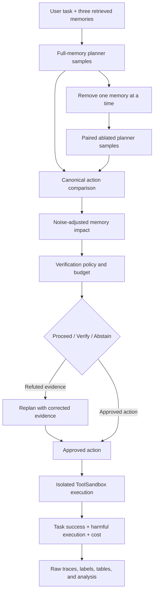
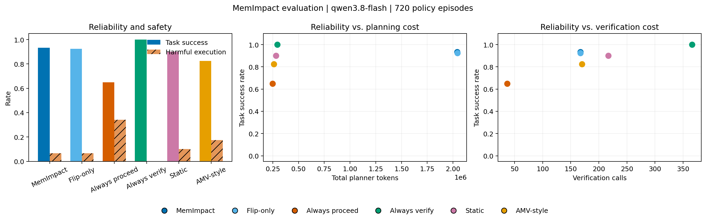

<div align="center">

# COMP7607 Group Project — MemImpact

**When does counterfactual memory auditing justify its cost?**

A reproducible study of planner-level memory removal, selective verification, and reliability–cost trade-offs in tool-using LLM agents.

**[English](README.md) · [简体中文](README.zh-CN.md)**

[](https://github.com/junjiacaohku-ai/COMP7607-Group-Project-MemImpact)
[](https://www.python.org/)
[](https://github.com/langchain-ai/langgraph)
[](#key-results)
[](report/memimpact_report.pdf)
[](https://github.com/junjiacaohku-ai/COMP7607-Group-Project-MemImpact/stargazers)

[Overview](#overview) · [Method](#method) · [Results](#key-results) · [Quick Start](#quick-start) · [Reproduction](#reproduction) · [Documentation](#documentation)

</div>

---

<a id="overview"></a>
## 1. Overview

Persistent memory helps LLM agents reuse contact details, preferences, and prior decisions across sessions. But a retrieved memory can be stale, misattributed, or irrelevant—and verifying every memory can be expensive.

**MemImpact** investigates a simple counterfactual question:

> If removing one memory changes the planner's proposed action, is that memory worth verifying before execution?

For each retrieved memory, the system removes it, re-runs the planner, compares the canonical tool actions, and uses the resulting impact signal to prioritize verification. The project evaluates not only whether this signal works, but also whether its reliability benefit justifies the additional planning calls, tokens, and latency.

> **Main finding:** Planner-level auditing has localized value for indirect action-selection errors, but we do **not** observe a stable overall reliability–cost advantage. Always Verify is more reliable in both held-out runs and uses roughly seven times fewer planner tokens than MemImpact.

This is a controlled synthetic study, not a general safety guarantee or a claim of universal method superiority.

## 2. What Is Included

| Capability | Delivered implementation |
|---|---|
| **Counterfactual memory audit** | Three paired full-memory and single-memory-removal planner samples per memory |
| **Noise-adjusted impact** | Canonical action comparison with a baseline estimated from full-memory planner variability |
| **Six evaluation policies** | MemImpact, flip-only, Always Proceed, Always Verify, Static, and AMV-Guard-style |
| **Executable benchmark** | 40 development episodes and 120 held-out episodes with five memory conditions |
| **Real tool execution** | LangGraph workflow connected to Apple ToolSandbox through an isolated worker process |
| **Offline critical-memory labels** | Forced verification-and-replanning trials based on outcome improvement, not action flips alone |
| **Statistical analysis** | Scenario-matched comparisons and base-scenario-clustered paired bootstrap intervals |
| **Full evidence trail** | Frozen configs, hashes, raw planner traces, failures, resumes, labels, CSV tables, and figures |
| **Research deliverables** | English proposal, 10-page project report, case studies, and claim-to-artifact appendix |

## 3. Method



For memory $m_i$, the raw action-flip rate is measured over $S=3$ paired samples:

$$\widehat F_i=\frac{1}{S}\sum_{s=1}^{S}\mathbf{1}\left[\mathcal A(a^{+,(s)})\neq\mathcal A(a_i^{-,(s)})\right].$$

Full-memory runs provide a planner-variability baseline $\widehat F_0$. MemImpact uses $\widetilde F_i=\max(0,\widehat F_i-\widehat F_0)$, together with memory age, provenance, and action consequence. The flip-only ablation ranks memories by $\widetilde F_i$ alone.

All counterfactual branches are planning-only. They cannot modify the ToolSandbox world or execute tools.

<a id="key-results"></a>
## 4. Key Results

Two frozen configurations evaluate the same 120 held-out scenarios with selective-verification budgets of one and three. Each run contains **120 scenarios × 6 policies = 720 policy episodes**.

| Policy | Success: B1 / B3 | Harmful execution: B1 / B3 | Planner tokens: B1 / B3 |
|---|---:|---:|---:|
| **MemImpact** | 94.17% / 93.33% | 5.00% / 6.67% | 1,991,454 / 2,039,438 |
| Flip-only | 84.17% / 92.50% | 15.00% / 6.67% | 1,970,405 / 2,043,155 |
| Always Proceed | 63.33% / 65.00% | 35.83% / 34.17% | 229,934 / 249,094 |
| **Always Verify** | **99.17% / 100%** | **0% / 0%** | **280,209 / 294,576** |
| Static | 89.17% / 90.00% | 10.00% / 10.00% | 268,841 / 280,438 |
| AMV-style | 80.83% / 82.50% | 18.33% / 17.50% | 249,486 / 261,984 |

### What the experiments establish

- **Full scoring is not consistently better than flip-only.** The paired success advantage is +10.00 percentage points in B1, but only +0.83 in B3.
- **Indirect dependencies expose a real distinction.** Literal candidate-conditioned auditing is weaker when a routing or selection rule—not the final argument itself—is wrong.
- **More verification capacity is not monotonically better.** Cross-budget success intervals for selective methods include zero; extra checks can be unnecessary.
- **Verification count is not total cost.** MemImpact checks fewer memories than Always Verify but performs far more planner work.
- **Negative results are preserved.** No held-out-driven prompt, threshold, score, or dataset retuning was performed.



Detailed intervals, subgroup results, failure analysis, and three case studies are in the [project report](report/memimpact_report.pdf).

## 5. Benchmark

| Dimension | Held-out design |
|---|---|
| **Task families** | Messaging and reminder deletion |
| **Memory conditions** | Valid, stale, conflicting, misattributed, irrelevant |
| **Consequence levels** | Low and high |
| **Dependence types** | Direct argument dependence and indirect action-selection dependence |
| **Scale** | 120 episodes, 12 base-scenario groups, three memories per episode |
| **Controls** | Frozen model, prompt, tools, decoding, scenarios, and policy order |
| **Model** | `qwen3.8-flash`, temperature 0, thinking enabled, at most two planner attempts |
| **Runtime** | `langgraph==1.2.20` with ToolSandbox in a separate Python environment |

A memory is labelled verification-critical only when verifying it turns the shared initial failed or harmful outcome into a successful, non-harmful result. Offline label-generation costs are reported separately from online policy costs.

<a id="quick-start"></a>
## 6. Quick Start

### Requirements

- macOS with native **Python 3.10**
- Two virtual environments: one for LangGraph and one for ToolSandbox
- Alibaba Cloud Model Studio credentials for live model runs
- Optional: [Tectonic](https://tectonic-typesetting.github.io/) for report compilation

### Clone and pin ToolSandbox

```bash
git clone https://github.com/junjiacaohku-ai/COMP7607-Group-Project-MemImpact.git
cd COMP7607-Group-Project-MemImpact

git clone https://github.com/apple-aiml-research/ToolSandbox.git third_party/ToolSandbox
git -C third_party/ToolSandbox checkout c8571d7854316d2e1c5f288e59fe1e34e53f6dd1
```

### Install the isolated environments

```bash
python3.10 -m venv .venv-toolsandbox
cd third_party/ToolSandbox
../../.venv-toolsandbox/bin/python -m pip install '.[dev]'
../../.venv-toolsandbox/bin/python -m pip install 'httpx==0.27.2'
cd ../..
.venv-toolsandbox/bin/python -m pip install -e . --no-deps

python3.10 -m venv .venv
.venv/bin/python -m pip install -e . 'langgraph==1.2.20' 'PyYAML==6.0.1'
```

**Do not mix the two environments.** ToolSandbox's older dependencies conflict with the current LangGraph stack.

### Configure live model access

Set credentials only in your local terminal. Never commit API keys or workspace credentials.

```zsh
read -s "DASHSCOPE_API_KEY?DashScope API Key: "
echo
read "DASHSCOPE_WORKSPACE_ID?Workspace ID: "
export DASHSCOPE_API_KEY
export DASHSCOPE_WORKSPACE_ID
export DASHSCOPE_REGION="cn-hongkong"
```

### Run one end-to-end episode

```bash
.venv/bin/python scripts/run_langgraph_smoke.py \
  --scenario benchmark/deletion_pilot/stale_target.json \
  --policy memimpact \
  --model qwen3.8-flash \
  --temperature 0 \
  --samples 3 \
  --max-planner-attempts 2
```

<a id="reproduction"></a>
## 7. Reproduction

### Frozen held-out runs

```bash
.venv/bin/python scripts/run_langgraph_comparison.py \
  --config configs/heldout_budget1_v1.yaml

.venv/bin/python scripts/run_langgraph_comparison.py \
  --config configs/heldout_budget3_v1.yaml
```

Each new run creates a separate timestamped directory. To resume an interrupted run without repeating saved results or shared planner samples:

```bash
.venv/bin/python scripts/run_langgraph_comparison.py \
  --config configs/heldout_budget1_v1.yaml \
  --resume results/heldout/heldout_budget1_v1_langgraph_20261113_013824
```

### Offline labels and analysis

```bash
.venv/bin/python scripts/generate_critical_labels.py RUN_DIRECTORY

.venv-toolsandbox/bin/python scripts/analyze_comparison.py \
  RUN_DIRECTORY/comparison_summary.json
```

### Matched budget comparison

```bash
.venv/bin/python scripts/compare_verification_budgets.py \
  results/heldout/heldout_budget1_v1_langgraph_20261113_013824 \
  results/heldout/heldout_budget3_v1_langgraph_20261113_141753
```

### Compile the report

```bash
cd report
tectonic memimpact_report.tex
```

## 8. Repository Structure

```text
memimpact/                 Core actions, scoring, policies, LangGraph runtime, and adapters
scripts/                   Smoke tests, batch runs, dataset generation, and analysis
benchmark/dev/             40 development episodes and manifest
benchmark/heldout/         120 frozen held-out episodes and manifest
configs/                   Frozen experiment configs and exported tool schemas
results/heldout/           Raw traces, labels, metrics, bootstrap intervals, and figures
proposal/                  Official English proposal, LaTeX source, and references
report/                    English project report and compiled PDF
docs/                      Implementation plan, meeting notes, and review material
README.md                  English project homepage
README.zh-CN.md            简体中文项目主页
WORKLOG.md                 Chronological implementation and experiment record
third_party/               Local ToolSandbox checkout; not committed
```

<a id="documentation"></a>
## 9. Documentation and Evidence

- [Project report PDF](report/memimpact_report.pdf)
- [Report LaTeX source](report/memimpact_report.tex)
- [Official English proposal](proposal/memimpact_proposal.pdf)
- [Implementation plan](docs/imp_plan.md)
- [Claim-to-artifact appendix](report/memimpact_report.tex#L360)
- [Budget-1 results](results/heldout/heldout_budget1_v1_langgraph_20261113_013824)
- [Budget-3 results](results/heldout/heldout_budget3_v1_langgraph_20261113_141753)
- [Matched budget comparison](results/heldout/heldout_budget3_v1_langgraph_20261113_141753/budget_matched_comparison.json)
- [Work log](WORKLOG.md)

## 10. Limitations

- Synthetic benchmark with only two held-out task families and twelve base-scenario clusters.
- One hosted model, three retrieved memories, and at most one state-changing action per episode.
- The AMV-style baseline is a simplified literal-argument-overlap adaptation, not a full AMV-Guard reproduction.
- Independent model calls across budgets do not identify a strict causal budget effect.
- Verification uses authoritative synthetic evidence; noisy or incomplete verifiers remain untested.
- Token and latency measurements do not provide a monetary cost estimate.
- Results do not establish general agent safety or transfer to open-ended real-world tasks.

## 11. Team

| Member | Student ID |
|---|---|
| Cao Junjia | 3036790730 |
| Zhang Yankai | 3036806682 |
| Wu Hongyao | 3036793196 |
| Kwan Tsz Hong | 3036792350 |
| Wang Zicheng | 3036790326 |

## 12. Status and Acknowledgements

The core implementation, frozen experiments, analysis, and report draft are complete. Presentation slides, a short demonstration, and the team-confirmed contribution record are delivery tasks remaining for the November 30 presentation.

Built with [LangGraph](https://github.com/langchain-ai/langgraph), [Apple ToolSandbox](https://github.com/apple-aiml-research/ToolSandbox), and Alibaba Cloud Model Studio Qwen. See the [references](proposal/references.bib) for related research.

---

<div align="center">

**MemImpact — Measure the memory's influence. Question whether the audit is worth it.**

HKU COMP7607A · Natural Language Processing · Group Project

</div>
