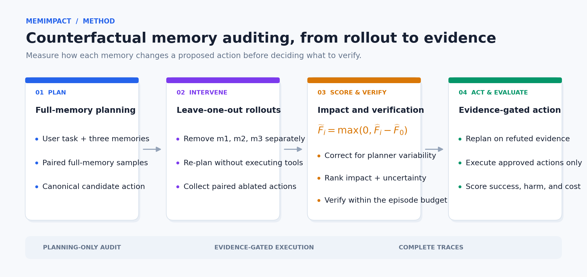
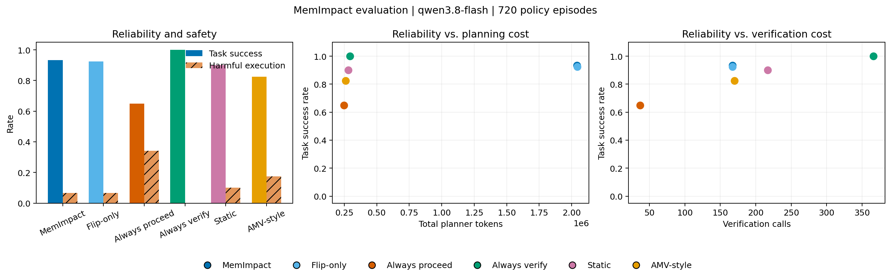

<div align="center">

# COMP7607 小组项目 — MemImpact

**反事实 Memory 审计的额外成本，真的值得吗？**

一个关于 Planner 级 Memory 移除、选择性验证，以及工具型 LLM Agent 可靠性—成本权衡的可复现研究。

**[English](README.md) · [简体中文](README.zh-CN.md)**

[](https://github.com/junjiacaohku-ai/COMP7607-Group-Project-MemImpact)
[](https://www.python.org/)
[](https://github.com/langchain-ai/langgraph)
[](#核心结果)
[](report/memimpact_report.pdf)
[](https://github.com/junjiacaohku-ai/COMP7607-Group-Project-MemImpact/stargazers)

[项目概览](#项目概览) · [方法](#方法) · [结果](#核心结果) · [快速开始](#快速开始) · [复现](#复现) · [文档](#文档与证据)

</div>

---

<a id="项目概览"></a>
## 1. 项目概览

持久化 Memory 让 LLM Agent 能够跨会话复用联系方式、用户偏好和历史决策。但被检索的 Memory 可能已经过期、归错对象，或与当前任务无关；而验证所有 Memory 又可能产生高昂成本。

**MemImpact** 研究一个直接的反事实问题：

> 如果移除一条 Memory 会改变 Planner 的候选动作，这条 Memory 是否值得在执行前验证？

系统逐条移除检索到的 Memory，重新运行 Planner，比较规范化后的工具动作，并使用动作影响信号安排验证顺序。项目不仅评估这个信号是否有效，也评估其可靠性收益能否抵消额外的规划调用、Token 和延迟。

> **主要发现：** Planner 级审计在部分间接动作选择错误中具有局部价值，但我们没有观察到稳定的整体可靠性—成本优势。Always Verify 在两轮 held-out 实验中都更可靠，而且 Planner Token 仅约为 MemImpact 的七分之一。

这是一项受控合成数据研究，不构成通用安全保证，也不宣称方法在所有场景下优于基线。

## 2. 已实现内容

| 能力 | 已交付实现 |
|---|---|
| **反事实 Memory 审计** | 每条 Memory 使用 3 组完整／单条移除的配对 Planner 样本 |
| **噪声校正影响力** | 规范化动作比较，并使用完整 Memory 规划波动估计基线 |
| **六种评价策略** | MemImpact、flip-only、Always Proceed、Always Verify、Static、AMV-Guard-style |
| **可执行 Benchmark** | 40 个开发 episodes、120 个 held-out episodes、五类 Memory 条件 |
| **真实工具执行** | LangGraph 工作流通过独立 worker 进程连接 Apple ToolSandbox |
| **离线关键记忆标签** | 基于结果改善的强制验证—重规划试验，而不是仅凭动作翻转 |
| **统计分析** | 同场景配对比较，以及按基础场景聚类的 paired bootstrap 区间 |
| **完整证据链** | 冻结配置、哈希、原始 Planner trace、失败、续跑、标签、CSV 和图 |
| **研究交付物** | 英文 Proposal、10 页项目报告、典型案例和 claim-to-artifact 附录 |

## 3. 方法

<div align="center">

</div>

对 Memory $m_i$，使用 $S=3$ 组配对样本计算原始动作翻转率：

$$\widehat F_i=\frac{1}{S}\sum_{s=1}^{S}\mathbf{1}\left[\mathcal A(a^{+,(s)})\neq\mathcal A(a_i^{-,(s)})\right].$$

完整 Memory 运行提供 Planner 波动基线 $\widehat F_0$。MemImpact 使用 $\widetilde F_i=\max(0,\widehat F_i-\widehat F_0)$，并结合 Memory 年龄、来源和动作后果；flip-only 消融只使用 $\widetilde F_i$ 排序。

所有反事实分支都只进行规划，不能修改 ToolSandbox 世界或执行工具。

<a id="核心结果"></a>
## 4. 核心结果

两套冻结配置使用相同的 120 个 held-out 场景，分别将选择性验证预算设为 1 和 3。每轮包含 **120 场景 × 6 策略 = 720 条 policy episodes**。

| 策略 | 成功率：B1 / B3 | 危险执行率：B1 / B3 | Planner Tokens：B1 / B3 |
|---|---:|---:|---:|
| **MemImpact** | 94.17% / 93.33% | 5.00% / 6.67% | 1,991,454 / 2,039,438 |
| Flip-only | 84.17% / 92.50% | 15.00% / 6.67% | 1,970,405 / 2,043,155 |
| Always Proceed | 63.33% / 65.00% | 35.83% / 34.17% | 229,934 / 249,094 |
| **Always Verify** | **99.17% / 100%** | **0% / 0%** | **280,209 / 294,576** |
| Static | 89.17% / 90.00% | 10.00% / 10.00% | 268,841 / 280,438 |
| AMV-style | 80.83% / 82.50% | 18.33% / 17.50% | 249,486 / 261,984 |

### 实验能够说明什么

- **完整评分并未稳定优于 flip-only。** 配对成功率差在 B1 为 +10.00 个百分点，在 B3 仅为 +0.83。
- **间接依赖体现了方法差异。** 当错误来自路由或选择规则，而不是最终参数本身时，字面候选动作审计更弱。
- **更大的验证预算不保证更好。** 选择性策略的跨预算成功率区间均包含 0，额外检查可能没有必要。
- **验证次数不等于总成本。** MemImpact 的 Memory 验证少于 Always Verify，但规划计算量远高于后者。
- **负向结果完整保留。** 没有根据 held-out 结果回调 Prompt、阈值、评分或数据。



详细区间、分组结果、失败分析和三个案例见[英文项目报告](report/memimpact_report.pdf)。

## 5. Benchmark 设计

| 维度 | Held-out 设计 |
|---|---|
| **任务族** | Messaging、Reminder Deletion |
| **Memory 条件** | Valid、Stale、Conflicting、Misattributed、Irrelevant |
| **后果等级** | Low、High |
| **依赖类型** | 直接参数依赖、间接动作选择依赖 |
| **规模** | 120 episodes、12 个基础场景组、每场景 3 条 Memory |
| **控制变量** | 冻结模型、Prompt、工具、解码、场景和策略顺序 |
| **模型** | `qwen3.8-flash`、temperature 0、开启思考、每次动作最多 2 次 Planner attempts |
| **运行环境** | `langgraph==1.2.20`，ToolSandbox 使用独立 Python 环境 |

只有当验证一条 Memory 能将共享初始失败／危险结果转变为成功且无危险执行的结果时，该 Memory 才被标为 verification-critical。离线标注成本与在线策略成本分开报告。

<a id="快速开始"></a>
## 6. 快速开始

### 环境要求

- macOS 原生 **Python 3.10**
- 两个虚拟环境：LangGraph 与 ToolSandbox 分开
- 真实模型运行需要阿里云百炼凭据
- 可选：使用 [Tectonic](https://tectonic-typesetting.github.io/) 编译报告

### 克隆项目并固定 ToolSandbox

```bash
git clone https://github.com/junjiacaohku-ai/COMP7607-Group-Project-MemImpact.git
cd COMP7607-Group-Project-MemImpact

git clone https://github.com/apple-aiml-research/ToolSandbox.git third_party/ToolSandbox
git -C third_party/ToolSandbox checkout c8571d7854316d2e1c5f288e59fe1e34e53f6dd1
```

### 安装隔离环境

```bash
python3.10 -m venv .venv-toolsandbox
cd third_party/ToolSandbox
../../.venv-toolsandbox/bin/python -m pip install '.[dev]'
../../.venv-toolsandbox/bin/python -m pip install 'httpx==0.27.2'
cd ../..
.venv-toolsandbox/bin/python -m pip install -e . --no-deps

python3.10 -m venv .venv
.venv/bin/python -m pip install -e . 'langgraph==1.2.20' 'PyYAML==6.0.1'
```

**不要混装两个环境。** ToolSandbox 的旧依赖与当前 LangGraph 依赖存在冲突。

### 配置真实模型

只在本地终端设置凭据，不要提交 API Key 或 Workspace 信息。

```zsh
read -s "DASHSCOPE_API_KEY?DashScope API Key: "
echo
read "DASHSCOPE_WORKSPACE_ID?Workspace ID: "
export DASHSCOPE_API_KEY
export DASHSCOPE_WORKSPACE_ID
export DASHSCOPE_REGION="cn-hongkong"
```

### 运行一个端到端 Episode

```bash
.venv/bin/python scripts/run_langgraph_smoke.py \
  --scenario benchmark/deletion_pilot/stale_target.json \
  --policy memimpact \
  --model qwen3.8-flash \
  --temperature 0 \
  --samples 3 \
  --max-planner-attempts 2
```

<a id="复现"></a>
## 7. 复现

### 冻结 held-out 实验

```bash
.venv/bin/python scripts/run_langgraph_comparison.py \
  --config configs/heldout_budget1_v1.yaml

.venv/bin/python scripts/run_langgraph_comparison.py \
  --config configs/heldout_budget3_v1.yaml
```

每次新运行都会创建独立时间戳目录。中断后使用原目录续跑，不重复已保存结果和共享 Planner 样本：

```bash
.venv/bin/python scripts/run_langgraph_comparison.py \
  --config configs/heldout_budget1_v1.yaml \
  --resume results/heldout/heldout_budget1_v1_langgraph_20261113_013824
```

### 离线标签与分析

```bash
.venv/bin/python scripts/generate_critical_labels.py RUN_DIRECTORY

.venv-toolsandbox/bin/python scripts/analyze_comparison.py \
  RUN_DIRECTORY/comparison_summary.json
```

### Matched 预算比较

```bash
.venv/bin/python scripts/compare_verification_budgets.py \
  results/heldout/heldout_budget1_v1_langgraph_20261113_013824 \
  results/heldout/heldout_budget3_v1_langgraph_20261113_141753
```

### 编译报告

```bash
cd report
tectonic memimpact_report.tex
```

## 8. 仓库结构

```text
memimpact/                 动作、评分、策略、LangGraph runtime 和适配器
scripts/                   Smoke test、批量实验、数据生成与分析
benchmark/dev/             40 个开发 episodes 与 manifest
benchmark/heldout/         120 个冻结 held-out episodes 与 manifest
configs/                   冻结实验配置与导出的工具 schema
results/heldout/           原始 trace、标签、指标、bootstrap 区间与图
proposal/                  官方英文 Proposal、LaTeX 源码与参考文献
report/                    英文项目报告与 PDF
docs/                      实施计划、组会材料与评审意见
README.md                  English project homepage
README.zh-CN.md            简体中文项目主页
WORKLOG.md                 按时间记录的实现与实验日志
third_party/               本地 ToolSandbox checkout，不提交到仓库
```

<a id="文档与证据"></a>
## 9. 文档与证据

- [项目报告 PDF](report/memimpact_report.pdf)
- [报告 LaTeX 源码](report/memimpact_report.tex)
- [官方英文 Proposal](proposal/memimpact_proposal.pdf)
- [实施计划](docs/imp_plan.md)
- [Claim-to-artifact 附录](report/memimpact_report.tex#L360)
- [Budget-1 结果](results/heldout/heldout_budget1_v1_langgraph_20261113_013824)
- [Budget-3 结果](results/heldout/heldout_budget3_v1_langgraph_20261113_141753)
- [Matched 预算比较](results/heldout/heldout_budget3_v1_langgraph_20261113_141753/budget_matched_comparison.json)
- [工作日志](WORKLOG.md)

## 10. 局限性

- 合成 Benchmark 只包含两个 held-out 任务族和 12 个基础场景聚类。
- 使用单一托管模型、三条检索 Memory，每个 episode 最多一个状态改变动作。
- AMV-style 是基于动作参数字面匹配的简化适配，不是 AMV-Guard 的完整复现。
- 两轮预算使用独立模型调用，不能识别严格的预算因果效应。
- 验证使用合成权威证据，尚未测试噪声或不完整 Verifier。
- Token 与延迟不等同于货币成本估计。
- 结果不构成通用 Agent 安全保证，也不能直接推广到开放真实任务。

## 11. 团队成员

| 成员 | 学号 |
|---|---|
| Cao Junjia | 3036790730 |
| Zhang Yankai | 3036806682 |
| Wu Hongyao | 3036793196 |
| Kwan Tsz Hong | 3036792350 |
| Wang Zicheng | 3036790326 |

## 12. 当前状态与致谢

核心实现、冻结实验、统计分析和报告初稿已完成。11 月 30 日展示前还需完成 slides、短演示和团队确认的贡献记录。

项目使用 [LangGraph](https://github.com/langchain-ai/langgraph)、[Apple ToolSandbox](https://github.com/apple-aiml-research/ToolSandbox) 和阿里云百炼 Qwen。相关研究见[参考文献](proposal/references.bib)。

---

<div align="center">

**MemImpact — 测量 Memory 的影响，也审视审计本身是否值得。**

HKU COMP7607A · Natural Language Processing · Group Project

</div>
