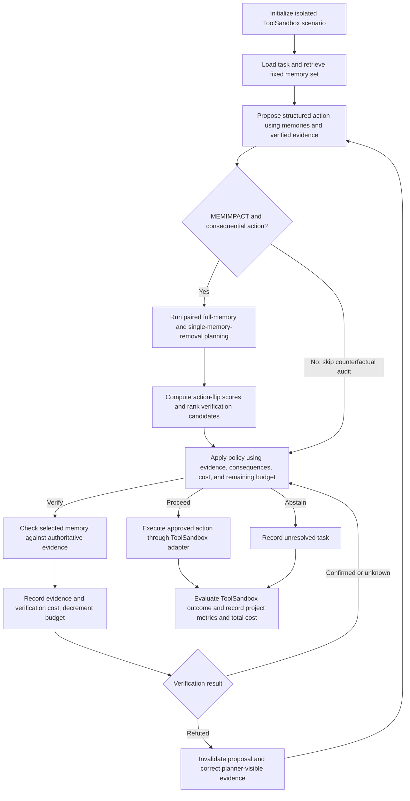

# MEMIMPACT — Project Proposal and Implementation Plan

## 1. Project objective and approach

MEMIMPACT investigates whether an AI agent can make better verification decisions by measuring how strongly individual memories influence its proposed actions.

For example, an agent remembers an outdated phone number. Before sending a message, MEMIMPACT temporarily removes that memory and asks the agent to plan again. If its proposed action changes, the memory may deserve verification—especially when sending to the wrong recipient would have serious consequences.

**The research question:** Does this additional planning improve correctness and safety enough to justify its computational cost?

The implementation will use **Python and LangGraph** for the agent workflow, with **LangChain and one provider integration** for model access. **Apple's ToolSandbox** will supply the simulated tools, world state, and task evaluation. The team will add the persistent-memory layer, MEMIMPACT policies, authoritative verification interface, and memory-specific scenarios and metrics. LangSmith will be optional infrastructure for tracing and experiment comparison. AppWorld remains an optional transfer extension outside the core scope.

The project will be presented as a **controlled synthetic study**, with conclusions limited to the implemented task families. A negative finding—such as simpler verification performing equally well at lower cost—is a valid research outcome.

Planning assumptions:

- Five workstreams with one accountable owner each.
- A three-week core schedule, with an optional fourth week.
- One hosted language model supporting structured tool calls.
- Synthetic users, memories, records, and actions.
- “Compulsory” means required for this project scope; submission formatting and assessment requirements follow the course rubric.

## 2. Architecture, dependencies, and shared interfaces

### Technology choices

| Layer | Choice | Responsibility |
|---|---|---|
| Language | **Python 3.11** | Implementation, experiments, and analysis |
| Agent runtime | **LangGraph** | Explicit workflow, state transitions, branching, and checkpoints |
| Model and tools | **LangChain + one provider integration package** | Model access, typed tool definitions, and structured action proposals |
| Memory | **LangGraph Store + JSONL snapshots** | Load prior-session memories and preserve reproducible memory records |
| Simulated environment and task evaluation | **Apple ToolSandbox + project adapter** | Simulated tools, world state, scenario initialization/reset, and trajectory evaluation |
| Validation | **Pydantic + pytest** | Structured records, component tests, and integration checks |
| Analysis | **pandas, SciPy, Matplotlib** | Metrics, uncertainty intervals, tables, and figures |
| Optional tracing | **LangSmith** | Inspect traces and compare experiments using the project’s evaluators |

Core agent and analysis dependencies are `langgraph`, `langchain`, the selected provider integration, `pydantic`, `pytest`, `pandas`, `scipy`, and `matplotlib`. Pin a ToolSandbox revision and its environment dependencies separately. Add `langsmith` for the optional tracing integration. Lock compatible versions after the initial smoke test.

LangGraph provides explicit workflow control, while LangChain exposes Python functions as typed tools. [LangGraph workflows](https://docs.langchain.com/oss/python/langgraph/workflows-agents), [LangChain tools](https://docs.langchain.com/oss/python/langchain/tools)

LangGraph controls the agent's state transitions; the project adapter connects that agent to ToolSandbox's agent/execution interface. ToolSandbox supplies the environment and native task evaluation; the project adds memory interventions, verification, and reliability/cost measurements. [ToolSandbox](https://github.com/apple-aiml-research/ToolSandbox)

The first integration smoke test must check dependency compatibility and run one agent decision through ToolSandbox execution and evaluation. ToolSandbox currently pins `langchain==0.1.3`; check whether the selected LangGraph/LangChain versions can share that environment. If the dependencies conflict, keep ToolSandbox in a separate process/environment behind an explicit adapter. Compatibility has not yet been validated. [ToolSandbox dependencies](https://github.com/apple-aiml-research/ToolSandbox/blob/main/pyproject.toml)

### Execution flow

LangGraph implements the control flow above. MEMIMPACT runs paired planning only for consequential candidate actions and at most the configured number of retrieved memories. Each comparison removes one memory while retaining the others; these branches propose actions without executing them. Baselines skip the counterfactual-audit nodes and apply their own policies within the same planning, verification, execution, and evaluation workflow.

Confirmed or unknown verification results return to the policy gate, which can proceed, select another useful check within budget, or abstain if an unresolved high-consequence premise prevents a safe action. Confirmation alone does not require replanning. Refuted evidence invalidates the candidate and triggers a fresh proposal using the corrected evidence. The gate stops checking when the estimated verification benefit is below its cost or no useful checks remain; an exhausted budget does not authorize an unsafe action.

Implementation rules:

- The planner proposes actions; a separate execution node performs approved actions.
- Counterfactual branches are planning-only and cannot execute tools.
- Each branch starts from the same pre-planning input. The removed memory must be absent from all planner-visible context, including copied history.
- Verification calls use one shared interface and an episode-wide budget.
- Confirmed and unknown results return to the policy gate without mandatory replanning. Do not repeat an uninformative check unless new evidence makes it useful; every check consumes the shared budget.
- Refuted evidence invalidates the old proposal and triggers replanning.
- Limit core episodes to one committed state-changing action and at most two replans. Select or adapt ToolSandbox scenarios to fit that restriction, with required setup completed before the trial. If the replan limit prevents constructing a safe replacement for an invalidated proposal, record an abstention.
- Keep simulated world state separate from agent-visible state. Explicitly copy or reset the world between trials; graph checkpoints alone do not restore external state.

### Memory and environment

Persist prior-session memories as JSONL and load them into a fresh LangGraph Store for each experimental run. Maintain separate namespaces for each scenario and trial. Automatic memory extraction and consolidation are outside the core.

LangGraph distinguishes conversation state from memories shared across sessions. An in-memory store must be explicitly reloaded from the saved records after restarting a run. [Memory documentation](https://docs.langchain.com/oss/python/concepts/memory)

Expose six logical operations through the ToolSandbox adapter, mapping them to the pinned ToolSandbox tool names and argument schemas rather than building an independent simulated world:

- `lookup_contact`
- `update_contact`
- `send_message`
- `lookup_reminder`
- `create_reminder`
- `delete_reminder`

These are project interface names, not assumed ToolSandbox API names. Reuse the corresponding ToolSandbox contact, messaging, and reminder tools; add read-only verification access where needed. Verification returns authorized observable evidence from the scenario's current records, while hidden evaluation labels remain inaccessible to the model. State-changing operations modify only the isolated ToolSandbox world.

Construct a memory-augmented ToolSandbox evaluation subset with synthetic prior sessions and controlled memory failures. Preserve native task evaluation where applicable, and report any scenario adaptations explicitly. Add project evaluators for harmful execution, verification-critical memories, coverage, and total cost; native ToolSandbox scores alone do not measure MEMIMPACT's research objectives.

### Shared interfaces

Agree these contracts before parallel implementation:

| Interface | Required behaviour |
|---|---|
| **Memory record** | Stable ID, claim text, entity/scope, timestamp, and provenance |
| **Planner** | Task, visible memories, and verified evidence → structured proposed action |
| **Verifier** | Memory claim → confirmed/refuted/unknown, supporting evidence, and cost |
| **Policy** | Candidate action, visible information, and remaining budget → proceed/verify/abstain |
| **Environment** | Apply an approved action to isolated state and return its result |
| **Evaluator** | Final state and hidden task expectations → correctness and harm outcomes |
| **Episode trace** | Scenario/configuration IDs, proposals, checks, replans, outcomes, calls, tokens, and timings |

The runtime owner maintains shared definitions. Contract changes require coordination with affected workstream owners.

## 3. Five independent workstreams

| Owner | Workstream and actionable items | Deliverables and boundary |
|---|---|---|
| **A** | **Agent integration and runtime:** establish compatible dependencies; implement the LangGraph workflow and ToolSandbox agent/tool adapter; connect the model; load memory snapshots; isolate trial state; normalize actions; record execution traces. | Runnable agent, ToolSandbox adapter, shared interfaces, configuration, and integration tests. Owns infrastructure; does not implement research policies or scenario labels. |
| **B** | **Environment and benchmark:** select/adapt ToolSandbox scenarios and existing tools; create synthetic prior sessions and current records; generate memory conditions; define correct/harmful outcomes; construct development/test splits; manually audit examples. | ToolSandbox scenario fixtures, scenario generator, dataset, authoritative verifier, and per-case outcome rules. Owns environment truth; does not choose verification strategies. |
| **C** | **MEMIMPACT method:** implement paired memory-removal planning; calculate action-flip scores; rank checks; manage verification decisions; implement the action-flip-only variant. | MEMIMPACT policies, method tests, and method documentation. Uses A’s runtime and B’s verifier. |
| **D** | **Baselines and literature:** implement comparison policies; verify directly relevant papers; document adaptation choices; maintain the related-work evidence table. | Baseline policies, comparison tests, introduction, and related-work section. Does not modify MEMIMPACT’s implementation. |
| **E** | **Experiments and delivery:** implement the batch runner; aggregate metrics; calculate uncertainty intervals; produce charts; analyse failures; link claims to traces; assemble report, slides, and demonstration. | Reproducible experiment commands, results, analysis, and final submission package. Uses B’s outcome rules rather than redefining correctness. |

To enable parallel work:

- A publishes interfaces and a minimal fake planner first.
- B supplies a small scenario fixture set.
- C and D develop against those fixtures.
- E develops analysis against example traces.
- Each owner writes their methods subsection during implementation; E edits the combined report.

## 4. Compulsory scope, extensions, and delivery phases

### Compulsory implementation and experiments

| Area | Required scope |
|---|---|
| **Task families** | Contact updates and reminder creation for development; messaging and reminder deletion for final testing |
| **Dataset** | Approximately 40 development episodes and 120 test episodes |
| **Test coverage** | Two test families × five memory conditions × two consequence levels × six scenario variants |
| **Memory conditions** | Valid, stale, conflicting, misattributed, and irrelevant |
| **Variation** | Vary constraints and world state, not just names; keep related variants in the same split |
| **Retrieved memories** | Up to three memories, held fixed across methods for each comparison |
| **Model** | One exact model identifier and decoding configuration, frozen after the pilot |
| **MEMIMPACT score** | Combine action-flip impact, observable uncertainty, action consequence, and verifier cost |
| **Paired planning** | Three paired trials per memory in the main evaluation; reuse each full-memory trial across removal comparisons |
| **Verification budgets** | One and three checks for selective methods; always-verify checks the complete retrieved set |
| **Reproducibility** | Versioned configurations, prompts, data-generation rules, traces, and analysis scripts |

Consequences must vary independently of memory correctness. Include old but valid memories and confidently stated incorrect memories so metadata does not trivially reveal the answer.

Keep these four baselines:

1. **Always proceed:** execute the candidate without additional verification.
2. **Always verify:** check all retrieved memories before deciding.
3. **Static policy:** use observable uncertainty, consequence, and cost without counterfactual planning.
4. **Candidate-conditioned policy:** identify premises supporting the proposed action and estimate the value of checking them, without memory-removal planning.

The fourth baseline must remain because it directly tests whether planner re-execution adds value beyond auditing a fixed proposed action. Document it as an **AMV-Guard-style adaptation**, including simplifications relative to the paper. [AMV-Guard](https://arxiv.org/html/2610.31446v1)

Also evaluate an **action-flip-only MEMIMPACT variant**. Share observable features and decision-handling rules across methods wherever applicable.

### Optional extensions, in priority order

| Priority | Addition |
|---|---|
| **First** | LangSmith experiment comparison, relevance-based baseline, adversarial memories, additional repeated trials |
| **Second** | Separate removal of uncertainty/consequence/cost terms, varying memory counts, incomplete or noisy verification |
| **Stretch** | Second model, CMI-style selection, oracle reference, outcome-shift scoring, longer plans, automatic memory formation with LangMem |

LangSmith supports dataset-based experiments and custom code evaluators. Core scoring and trace export must also work locally. [LangSmith evaluation](https://docs.langchain.com/langsmith/evaluation)

### Schedule and exit criteria

| Phase | Required work | Exit criterion |
|---|---|---|
| **Week 1 — Foundation** | Validate dependency compatibility; establish interfaces, LangGraph runtime, ToolSandbox adapter, initial scenarios, baseline skeletons, and analysis fixtures. Begin the report outline. | One complete ToolSandbox episode runs through planning, verification, execution, scoring, and trace export. |
| **Week 2 — Core and pilot** | Integrate all required policies. Run a 20-episode development pilot. Inspect scenario quality, state isolation, failures, and API usage. | Freeze model, prompts, thresholds, dataset splits, and experiment configuration. |
| **Week 3 — Evaluation and submission** | Run the held-out test matrix, analyse results, inspect failures, finish report/slides, and rehearse the demonstration. | Every reported result is traceable and the submission can be reproduced. |
| **Optional Week 4 — Validation** | Repeat predefined cases, reproduce figures, review conclusions, and add at most one extension. | Stronger evidence without destabilising the completed core. |

Reserve the final three days for analysis, writing, and delivery. Optional work starts only after the full core pipeline works.

Use measured pilot usage to establish the experiment spending cap before the main run. Three memories and three paired trials require **12 planner calls per audited decision**, before verification and replanning.

## 5. Validation, metrics, and final deliverables

### Required tests

- Memory removal changes only the intended planner input.
- Counterfactual branches cannot modify shared memory or world state.
- Equivalent tool names and normalized arguments compare equal.
- Execution cannot bypass the verification gate.
- Non-consequential actions skip MEMIMPACT's counterfactual audit; confirmed and unknown checks return to the policy gate without forcing a replan.
- Refuted evidence prevents execution of the old candidate.
- The ToolSandbox adapter preserves tool arguments/results, isolates trial state, and records native task evaluation alongside project metrics.
- Unknown verification, exhausted budgets, and replan limits terminate correctly.
- Hidden truth and scenario-condition labels never enter model prompts or policy inputs.
- Failed calls, malformed actions, and retries are recorded consistently.
- Identical scenario/configuration inputs can be reconstructed from saved artifacts.

### Required measurements

| Metric | Purpose |
|---|---|
| Task success | Measure correct completion |
| Harmful execution rate | Measure harmful actions actually performed |
| Proceed coverage and abstention rate | Expose strategies that achieve apparent safety through refusal |
| Safe-proceed recall | Measure whether originally safe candidates are allowed to execute |
| Critical-memory precision and recall | Assess whether the policy identifies memories whose verification improves a decision |
| Verification calls | Measure checking effort |
| Total calls, tokens, cost, and latency | Include planning, auditing, verification, retries, and replanning |

Define denominators before evaluation. Report harmful execution over all evaluated episodes, and distinguish safe-original-candidate execution from successful execution after replanning.

Generate critical-memory labels through separate offline verification-and-replanning trials, scored against the simulated outcomes. Action changes alone are not correctness labels. Account for label-generation costs separately from deployed policy costs.

Compare methods on matched cases. Use paired bootstrap confidence intervals, grouping related variants by base scenario. Include unchanged-memory reruns on a predefined subset to estimate ordinary planner variability. Report limitations arising from the small number of task families.

Final deliverables:

- Runnable implementation with locked dependencies and experiment commands.
- Versioned synthetic dataset and generation rules.
- Saved configurations, prompts, traces, and outcome records.
- Results table and reliability-versus-total-cost figures.
- Representative success, failure, and unnecessary-verification examples.
- Report, presentation, short demonstration, and contribution record.
- A claim-to-artifact appendix connecting reported findings to their evidence.

Acceptance requires a complete, reproducible comparison and supported conclusions. It does not require MEMIMPACT to outperform every baseline.
